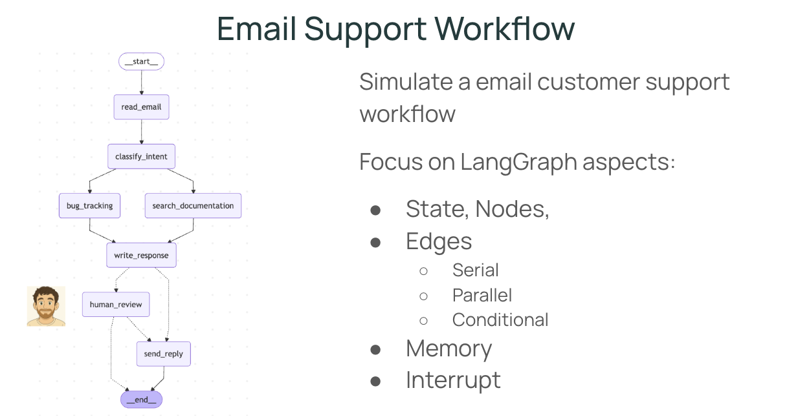

# LangGraph Email Agent

A customer-support email agent built with [LangGraph](https://langchain-ai.github.io/langgraph/). It classifies each incoming email with an LLM, gathers context in parallel, drafts a reply, and **pauses for a person to approve** any reply that is urgent or complex before it is sent.



## How it works

```
START → read_email → classify_intent ─┬─ search_documentation ─┬─ write_response
                                      └─ bug_tracking ─────────┘
write_response → send_reply → END                   (routine emails)
write_response → human_review → send_reply | END    (urgent or complex emails)
```

| Node | What it does |
|---|---|
| `classify_intent` | The LLM returns structured output: intent (`question`, `bug`, `billing`, `feature`, `complex`), urgency, topic, and summary |
| `search_documentation`, `bug_tracking` | Run **in parallel**, then both feed `write_response` |
| `write_response` | The LLM drafts a reply, then routes with `Command(goto=...)` |
| `human_review` | `interrupt()` pauses the graph until a reviewer approves, edits, or rejects the draft |
| `send_reply` | Sends the approved reply |

Emails with `high` or `critical` urgency, or a `complex` intent, go to human review. Everything else is sent automatically.

### LangGraph concepts used

- **State**: a shared `TypedDict` ([state.py](src/email_agent/state.py)) that each node reads and partially updates
- **Parallel edges** (fan-out and fan-in) for gathering context
- **`Command`** for routing from inside a node
- **Checkpointing**: each email runs in its own `thread_id`, so a paused run can be resumed later
- **Human in the loop**: `interrupt()` to pause, `Command(resume=...)` to continue

## Quick start

Requires Python 3.11–3.13 and [uv](https://docs.astral.sh/uv/).

```bash
git clone <this-repo-url>
cd langgraph-email-agent
uv sync
cp .env.example .env    # then add your API key
```

The agent works with any OpenAI-compatible endpoint. It defaults to a free-tier model on [NVIDIA build](https://build.nvidia.com): set `NVIDIA_API_KEY` in `.env`. To use OpenAI instead, see the comments in [.env.example](.env.example).

### Run it in the terminal

```bash
uv run email-agent --demo     # run 5 sample emails, review the urgent ones yourself
uv run email-agent            # type your own emails
```

When a draft needs review, you'll see it and choose to **[a]pprove**, **[e]dit**, or **[r]eject** it. Add `--auto-approve` to skip the prompts.

### Run it in LangGraph Studio

```bash
uv run langgraph dev
```

This opens Studio in your browser. Submit an input such as:

```json
{"email_content": "I was charged twice for my subscription! This is urgent!", "sender_email": "customer@example.com", "email_id": "email_123"}
```

When the graph pauses at `human_review`, resume it with JSON such as `{"approved": true}`, `{"approved": true, "edited_response": "..."}`, or `{"approved": false}`.

### Tracing with LangSmith (optional)

Set `LANGSMITH_TRACING=true` and `LANGSMITH_API_KEY` in `.env` to see every node, prompt, and model call at [smith.langchain.com](https://smith.langchain.com).

## Tests

The tests replace the LLM with a fake one, so they run offline with no API key:

```bash
uv run pytest
```

## Project structure

```
src/email_agent/
├── state.py    # State schemas
├── llm.py      # Model configuration (OpenAI-compatible)
├── nodes.py    # One function per graph node
├── graph.py    # Graph wiring; `graph` is the Studio entry point
└── cli.py      # Terminal demo with interactive review
tests/          # Offline tests with a fake LLM
```

## Making it real

`search_documentation`, `bug_tracking`, and `send_reply` are placeholders. To use this in production, you would:

- Connect `search_documentation` to a real knowledge base (vector store or docs API)
- Create real tickets in Jira, Linear, or GitHub Issues from `bug_tracking`
- Send through an email provider in `send_reply`
- Replace `InMemorySaver` with a persistent checkpointer such as `langgraph-checkpoint-postgres`, so paused reviews survive restarts

## Credits

Based on Lab 6 of LangChain Academy's [LangGraph Essentials](https://github.com/langchain-ai/lca-langgraph-essentials) course (MIT License). This version is restructured into a package and adds a configurable LLM provider, a terminal review flow, and offline tests.

## License

[MIT](LICENSE)
